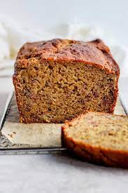

# Better-For-You Banana Bread

## Ingredients
- 1¼ cups (6¼ oz) all-purpose flour
- ½ cup (2¾ oz) whole wheat flour
- ¾ cup (5¼ oz) sugar
- 2 tsp baking powder
- ¾ tsp baking soda
- ½ tsp salt
- ¼ tsp ground cinnamon
- ¼ tsp ground nutmeg
- 3 large ripe bananas, peeled and mashed well
- 4 Tbsp (½ stick) unsalted butter, melted and cooled
- 2 large eggs
- ¼ cup lowfat plain yogurt
- 1 tsp vanilla extract
- ½ cup walnuts, toasted and chopped coarse (optional)

## Steps
1. Pre-heat the oven to 325°F and lightly coat a loaf pan with vegetable oil spray.
2. Whisk the all-purpose flour, whole-wheat flour, sugar, baking powder, baking soda, salt, cinnamon, and nutmeg together in a large bowl.
3. In a separate bowl, whisk the mashed bananas melted butter, eggs, yogurt, and vanilla together.
4. Gently fold the banana mixture and walnuts (if using) into the flour mixture with a rubber spatula until just combined (do not overmix). Scrape the batter into the prepared pan and smooth the top.
5. Bake until golden brown and a toothpick comes out with just a few crumbs attached (55 to 65 minutes), rotating the pan halfway through baking
6. Let the loaf cool in the pan for 10 minutes, then turn out onto a wire rack and let cool for 1 hour before serving.

## Notes
