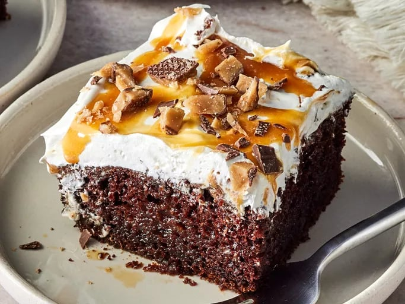

# Better Than Sex Cake

## Ingredients
- 1 (15.25 oz) package devil's food cake mix
- 1¼ cups water
- ½ cup vegetable oil
- 3 large eggs
- ½ (14 oz) can sweetened condensed milk
- 8 oz caramel ice cream topping, divided
- 3¼ (1.4 oz) bars chocolate-covered toffee, chopped
- 1 (8 oz) container frozen whipped topping, thawed

## Steps
1. Preheat the oven to 350°F. Grease the bottom of a 9x13-inch glass pan.
2. Mix the cake mix, water, oil and eggs in a large bowl with a mixer on medium speed until well combined. Pour into the prepared pan.
3. Bake until a toothpick inserted in the center comes out clean, 30 to 35 minutes. Cool on a wire rack for 5 minutes, then cut shallow slits across the top, without touching the bottom of the dish.
4. Meanwhile, combine the sweetened condensed milk and 6 oz of the caramel topping in a saucepan over low heat and stir until smooth.
5. Slowly pour the mixture over the warm cake and let it soak in. Set aside 1 to 2 Tbsp of the chopped toffee for decorating and sprinkle the rest over the whole cake.
6. Cool the cake completely, then top with the whipped topping. Decorate with the reserved toffee and drizzle with the remaining caramel topping.
7. Refrigerate until chilled through and serve right from the pan.

## Notes
- Crush the toffee into small chunks instead of crumbs, so there are pieces to chew on.
