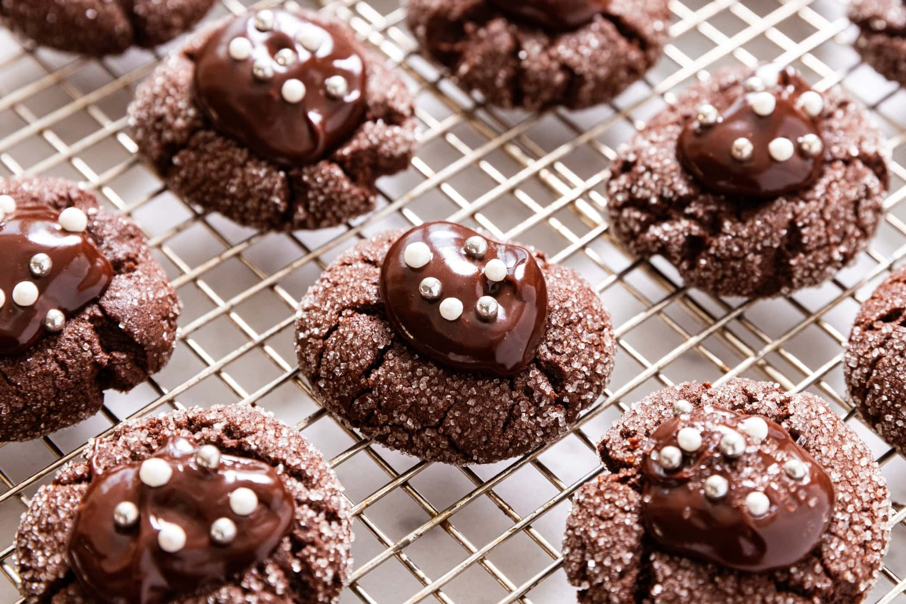

# Chocolate-Covered Cherry Cookies

## Ingredients
### Cookies
- 8 Tbsp (1 stick) unsalted butter
- 1 cup granulated sugar
- 1 large egg
- 1 tsp vanilla extract
- 1½ cups all-purpose flour
- ½ cup Dutch-process cocoa powder, sifted
- ¼ tsp kosher salt
- ¼ tsp baking powder
- ¼ tsp baking soda
- 1 jar (10 oz) maraschino cherries
- Sanding or white granulated sugar, for rolling

### Ganache
- ¾ cup semi-sweet chocolate chips
- ¾ cup heavy cream
- 1 Tbsp reserved cherry juice

## Tools
- Cookie scoop
- Parchment-lined cookie sheet

## Steps
1. Preheat the oven to 350°F.
2. Cream the butter and sugar in a large bowl until light and fluffy, then mix in the egg and vanilla until smooth.
3. Slowly add the flour, cocoa, baking powder, baking soda and salt, and beat until combined. The dough will be dry and almost crumbly.
4. Scoop the dough into 1 Tbsp balls, roll them in sanding or white sugar, and place them on a parchment-lined cookie sheet.
5. Drain the cherries, saving the juice, and pat them very dry. Cut extra-large cherries in half. Press a cherry firmly into the center of each dough ball.
6. Bake at 350°F for 10 to 12 minutes, until the cookies are set. Cool for 5 minutes.
7. While the cookies bake, heat the cream until it just begins to simmer. Pour it over the chocolate chips and let sit for 3 to 5 minutes, then stir slowly until smooth. Stir in 1 Tbsp of the reserved cherry juice.
8. Once the ganache has cooled slightly and thickened, spoon 1 to 2 tsp onto each warm cookie, covering the cherry. Sprinkle with sugar or decorations if desired.

## Notes
- Pat the cherries very dry so the cookies hold together.
