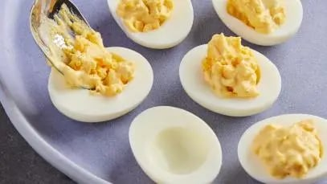

# Classic Deviled Eggs

## Ingredients
- 6 eggs
- ¼ cup mayonnaise
- 1 tsp white vinegar
- 1 tsp yellow mustard
- ⅛ tsp salt
- Freshly ground black pepper
- Smoked Spanish paprika, for garnish

## Steps
1. Place the eggs in a single layer in a saucepan and cover with water so there is 1½ inches of water above the eggs. Heat on high until the water begins to boil, then cover, turn the heat to low, and cook for 1 minute.
2. Remove from the heat and leave covered for 14 minutes, then rinse under cold water for 1 minute.
3. Crack the shells and carefully peel the eggs under cool running water. Gently dry with paper towels.
4. Slice the eggs in half lengthwise. Put the yolks in a medium bowl and the whites on a serving platter.
5. Mash the yolks into a fine crumble with a fork. Add the mayonnaise, vinegar, mustard, salt and pepper and mix well.
6. Spoon heaping teaspoons of the yolk mixture into the egg whites. Sprinkle with paprika and serve.
