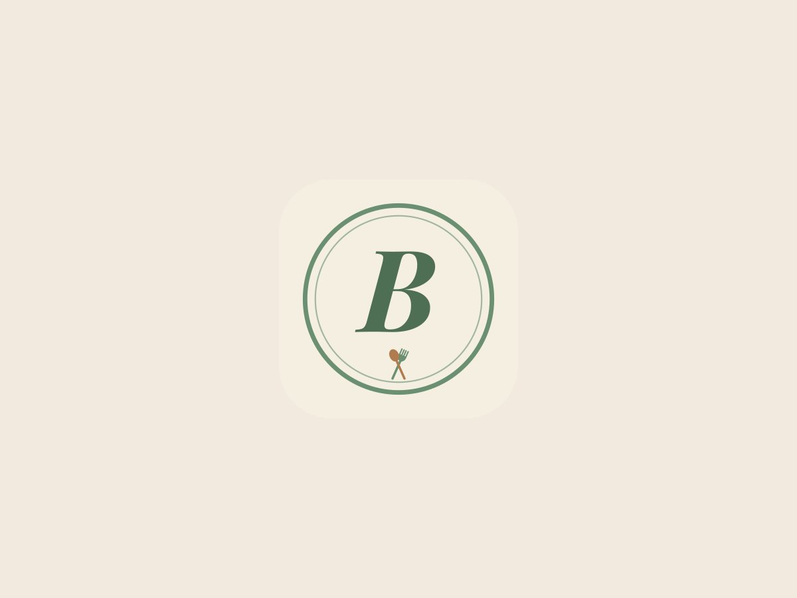

# Easy Blackstone Chicken Gyros

## Ingredients
- Cooking oil
- 1½ lb boneless, skinless chicken thighs, cut into bite-size pieces (or chicken breasts)
- 1 pint grape tomatoes
- Kosher salt, pepper and crushed red pepper flakes
- 1 tsp lemon pepper seasoning
- 1 tsp dried oregano
- 1 tsp paprika
- 1 tsp garlic powder
- 2 packages (4-pack) mini naan bread
- ½ cup tzatziki
- ½ cup shredded lettuce
- ½ cup crumbled feta

## Tools
- Flat top griddle (Blackstone)
- Spatulas

## Steps
1. Preheat the griddle to medium. Add oil, the chicken, tomatoes, salt, pepper and red pepper flakes, and cook for 5 minutes, mixing with spatulas.
2. Add the lemon pepper, oregano, paprika and garlic powder and cook 5 more minutes, mixing a few times.
3. In the last minute, put the naan on an empty spot on the griddle to warm and toast.
4. Fill the naan with chicken and tomatoes, then top with tzatziki, lettuce and feta.

## Notes
- A good camping recipe, since it all cooks on the griddle.
