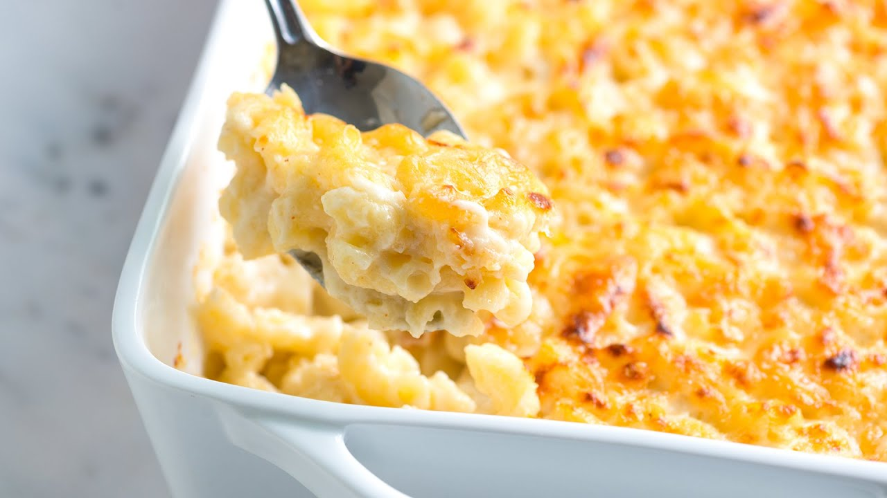

# Mac and Cheese Deluxe

## Ingredients
- 14 oz large elbow mac
- 4 cups small-curd cottage cheese
- 2 cups sour cream
- 2 slightly beaten eggs
- 1½ tsp salt
- dash pepper
- 16 oz sharp cheddar cheese, grated (4 cups)
- paprika

## Steps
1. Cook/Drain Pasta according to package directions
2. Combine cottage cheese, sour cream, egg, salt, pepper
3. Add cheddar
4. Add macaroni
5. Put in GREASED casserole dish (9x13)
6. Bake @ 350°F for 45 mins

## Notes
