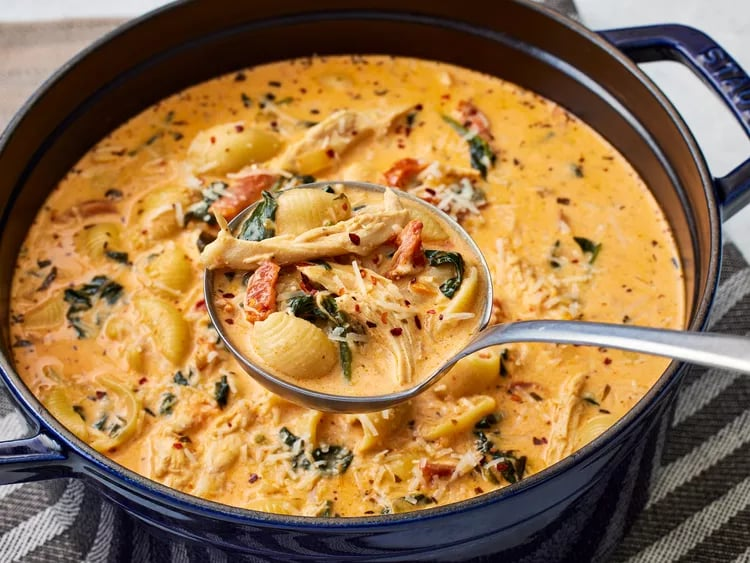

# Marry Me Chicken Soup

## Ingredients
- ½ cup drained julienne-cut sun-dried tomatoes packed in oil with herbs
- 1 Tbsp oil from the sun-dried tomato jar
- 1½ cups chopped yellow onion
- 4 medium garlic cloves, minced
- 3 Tbsp tomato paste
- 2 (32 oz) packages chicken broth
- 1 cup heavy whipping cream
- 4 tsp chopped fresh basil, plus more for garnish (optional)
- 2 tsp kosher salt
- 1½ tsp dried Italian seasoning
- 1 tsp garlic powder
- ¼ tsp crushed red pepper, plus more for garnish
- 8 oz uncooked medium shell pasta
- 3 cups packed roughly chopped fresh baby spinach
- 2 cups shredded rotisserie chicken
- 8 oz cream cheese, cubed, at room temperature
- 1½ oz Parmesan cheese, finely shredded, plus more for garnish

## Steps
1. Heat the sun-dried tomato oil in a large Dutch oven over medium until shimmering. Add the onion and garlic and cook, stirring often, until softened, 3 to 4 minutes.
2. Add the tomato paste and sun-dried tomatoes and cook, stirring constantly, until the paste is slightly deeper red, about 2 minutes.
3. Stir in the broth, cream, basil, salt, Italian seasoning, garlic powder and crushed red pepper. Bring to a boil over medium, stirring occasionally, about 12 minutes.
4. Add the pasta and reduce the heat to medium-low. Cook, stirring occasionally, until the pasta is al dente, about 12 minutes.
5. Reduce the heat to low and add the spinach, chicken, cream cheese and Parmesan. Cook, stirring often, until the cheeses are melted and the chicken is heated through, about 5 minutes.
6. Garnish with more Parmesan, basil and crushed red pepper. Serve immediately.
