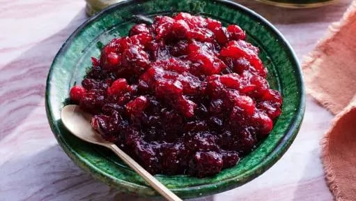

# Perfect Cranberry Sauce

## Ingredients
- 12 oz fresh or frozen cranberries
- 1 cup sugar, plus more to taste
- 1 strip orange or lemon zest
- 2 Tbsp water
- Salt, to taste
- Pepper, to taste

## Steps
1. Empty the cranberries into a saucepan and move ½ cup to a small bowl.
2. Add the sugar, zest and water to the pan. Cook over low heat, stirring occasionally, until the sugar dissolves and the cranberries are soft, about 10 minutes.
3. Increase the heat to medium and cook until the cranberries burst, about 12 minutes.
4. Reduce the heat to low and stir in the reserved cranberries. Add sugar, salt and pepper to taste.
5. Cool to room temperature before serving.

## Notes
- Make it a day or two ahead; the flavor gets better as it sits.
- Leftovers are good on turkey sandwiches, pancakes and waffles, or mixed with BBQ sauce and brushed on chicken or pork.
