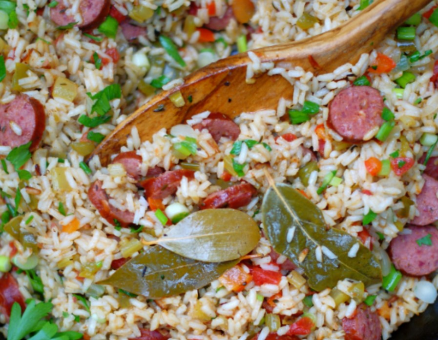

# Sausage Jambalaya

## Ingredients
- 1½ tsp minced garlic
- 1 cup diced yellow onion
- 1 cup diced green bell pepper
- 1 cup diced celery
- 1 lb smoked sausage (beef or pork), sliced into half moons
- 14½ oz can of diced tomatoes
- 3 cups chicken broth (or chicken stock)
- 2 tsp Tony Chachere's seasoning
- 2 bay leaves
- ½ tsp dried thyme
- ½ tsp dried oregano
- ¼ tsp cayenne pepper
- 2 cups long grain rice
- 4 to 5 green onions, chopped
- 2 Tbsp chopped fresh parsley

## Steps
1. Brown sausage in a dutch oven over medium-high heat until browned and some fat has rendered.
2. Add garlic. Stir while garlic lightly browns. Add onions, bell pepper and celery. Sauté until softened but not quite translucent.
3. Add in canned tomatoes and broth. Stir to remove any browned bits of sausage from the bottom of the skillet. Stir in dried herbs and spices. Let come to a low boil.
4. Add rice and stir to incorporate.
5. Turn heat down to low, cover and let cook for 25-35 minutes or until rice is fluffy. Stir occasionally to make sure rice does not stick. There should be little or no liquid left.
6. Remove from heat. Stir in chopped green onions and parsley and serve.

## Notes
