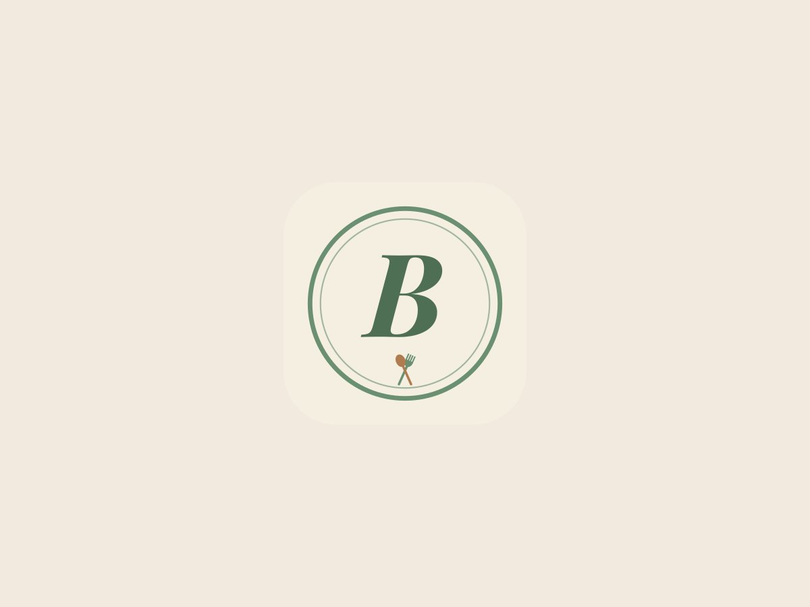

# Slow Cooker Thai Inspired Chicken Curry

## Ingredients
- 2 lb boneless skinless chicken thighs (or breasts)
- 1 can full-fat coconut milk
- ½ cup chicken stock
- 2 Tbsp Thai red curry paste
- 2 Tbsp finely chopped ginger
- 2 garlic cloves, finely minced
- 1 red bell pepper, thinly sliced
- ½ cup thinly sliced onion
- 1½ tsp kosher salt
- 1 tsp sugar
- ½ tsp black pepper
- Fresh lime juice, to taste
- Cilantro, for topping
- Green onions, for topping
- Red chiles, for topping (or another chile)

## Tools
- Slow cooker

## Steps
1. Whisk the coconut milk, chicken stock, curry paste, ginger, garlic, salt, sugar and pepper together in the slow cooker.
2. Add the bell pepper and onion, then layer in the chicken and turn it to coat both sides with the sauce.
3. Nestle the chicken into the sauce, cover, and cook on low for 5 hours.
4. Serve the chicken and sauce over rice, with noodles, or with steamed veggies.
5. Squeeze fresh lime on top and finish with cilantro, red chiles and green onions.

## Notes
- Add more curry paste for more heat and flavor. As written it is mild enough for kids.
- The flavors deepen overnight, so it is good for leftovers and meal prep.
