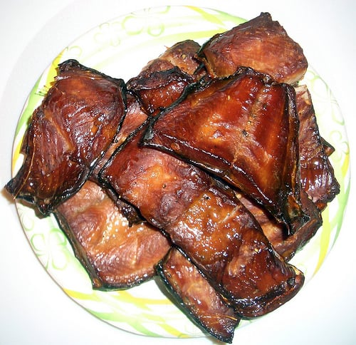

# Smoked Salmon

## Ingredients
- Salmon
### Brine
- ½ cup white sugar
- ½ cup brown sugar
- ½ cup salt
- Water, enough to cover the fish
### Seasoning
- Rub
- Salt
- Pepper
- Honey

## Steps
1. Mix the white sugar, brown sugar and salt in water to make a brine. Brine the salmon for 4 hours.
2. Rinse the fish.
3. Season with rub, salt and pepper.
4. Smoke at 170°F for about 2 hours, until the fish reaches 140°F to 145°F.
5. Add honey after 1 hour of smoking.

## Notes
- Photo: "Smoked Salmon" by GEMalone, CC BY 3.0, via Wikimedia Commons.
