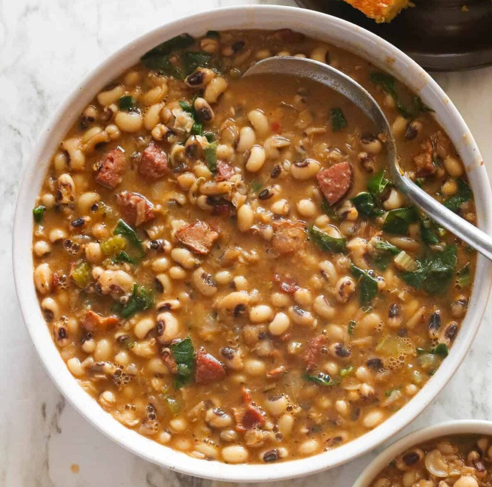

# Southern Black-Eyed Peas

## Ingredients
- 1 lb dried black-eyed peas
- 4 to 5 thick slices bacon, chopped
- 5 oz smoked sausage or turkey, diced (about 1 cup)
- 1 large onion, diced
- 1 stalk celery, diced
- 2 to 3 tsp garlic, minced
- 1 jalapeno, minced (optional; or use ¼ tsp cayenne)
- 2 tsp fresh thyme, minced
- 1 bay leaf
- 1 to 2 tsp Creole seasoning
- 7 to 8 cups chicken broth
- 2 cups collard greens (or kale), or more
- Salt and pepper, to taste
- Chopped green onion, for garnish
- Cooked rice, for serving

## Steps
1. Rinse the peas, pick through them, and put them in a large pot. Cover with 3 to 4 inches of cold water and soak for 2 to 3 hours, or overnight.
2. In a large heavy pan, cook the bacon until brown and crispy, 4 to 5 minutes. Add the sausage and cook 2 to 3 minutes more. Remove the bacon and sausage and set aside.
3. Add the onion, celery, garlic, jalapeno, thyme and bay leaf to the pan and cook 3 to 5 minutes, until the onion is soft and fragrant.
4. Pour in the chicken broth.
5. Drain and rinse the soaked peas and add them to the pot. Season with the Creole seasoning and salt. Stir and bring to a boil.
6. Reduce to a simmer and cook uncovered for about 20 minutes.
7. Stir in the collard greens, bacon and sausage. Cook 10 minutes or more, stirring now and then, until the peas are tender and the broth thickens. Add more broth or water if it gets too dry; the peas should be thick and creamy, not watery.
8. Remove the bay leaf and adjust the salt, pepper and Creole seasoning. Serve over rice and garnish with green onion.

## Notes
- Many readers find the peas take about 1½ hours to get tender. A pressure cooker will speed things up.
- A traditional Southern dish (Hoppin' John) served on New Year's Day for good luck.
