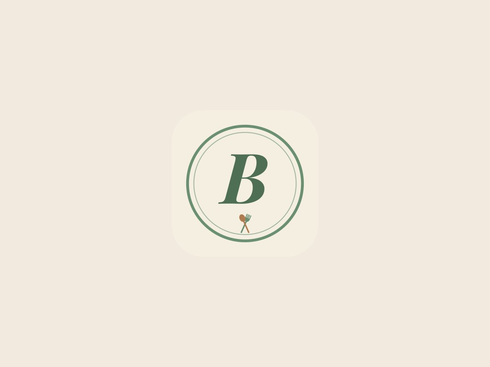

# The Best Chocolate Sheet Cake Ever

## Ingredients
### Cake
- 2 cups all-purpose flour
- 2 cups sugar
- ¼ tsp kosher salt
- 1 cup butter
- 4 Tbsp (heaping) cocoa powder
- 1 cup boiling water
- ½ cup buttermilk
- 2 eggs, beaten
- 1 tsp baking soda
- 1 tsp vanilla extract

### Icing
- ½ cup plus 6 Tbsp butter
- 4 Tbsp (heaping) cocoa powder
- 6 Tbsp milk
- 1 tsp vanilla extract
- 1 lb powdered sugar, minus ½ cup
- 1 cup chopped pecans

## Tools
- 18 by 13 inch sheet cake pan

## Steps
1. Combine the flour, sugar and salt in a mixing bowl.
2. Melt the butter in a saucepan and stir in the cocoa. Add the boiling water and boil for 30 seconds, then turn off the heat. Pour over the flour mixture and stir lightly to cool.
3. In a measuring cup, mix the buttermilk with the beaten eggs, baking soda and vanilla. Stir it into the chocolate mixture.
4. Pour the batter into an 18 by 13 inch sheet cake pan and bake at 350°F for 20 minutes.
5. While the cake bakes, melt the icing butter in a saucepan. Stir in the cocoa and turn off the heat.
6. Stir in the milk, vanilla and powdered sugar, then add the pecans.
7. Pour the icing over the warm cake and cut into squares.

## Notes
- The icing goes on while the cake is still warm.
