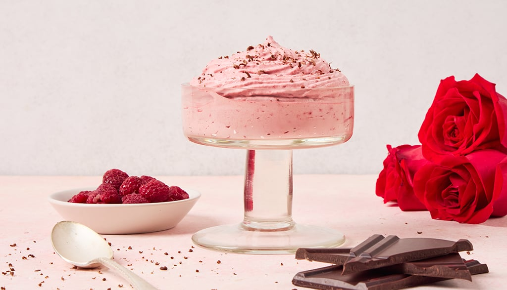

# Whipped Raspberry Clouds

## Ingredients
- 1 cup heavy whipping cream
- ½ tsp vanilla extract
- 2 cups frozen raspberries
- 1 to 2 Tbsp maple syrup (1 Tbsp makes it tarter)
- 1 Tbsp cocoa powder
- Frozen raspberries, chocolate chips, cocoa powder or shaved chocolate, for topping (optional)

## Steps
1. Whip the cream and vanilla to soft, medium peaks, 5 to 7 minutes. Set aside.
2. Blend the frozen raspberries and maple syrup in a food processor for 10 to 15 seconds, until they look like coarse sand.
3. Gently fold the blended raspberries and cocoa powder into the whipped cream.
4. Divide among four small, clear glasses or dessert cups and refrigerate for 1 hour for the best texture.

## Notes
- For a dairy-free version, replace the cream, vanilla and maple syrup with 2 cups coconut whipped topping and just stir in the raspberries and cocoa.
- Make it ahead and refrigerate until ready to serve. Leftovers keep up to 3 days in an airtight container.
